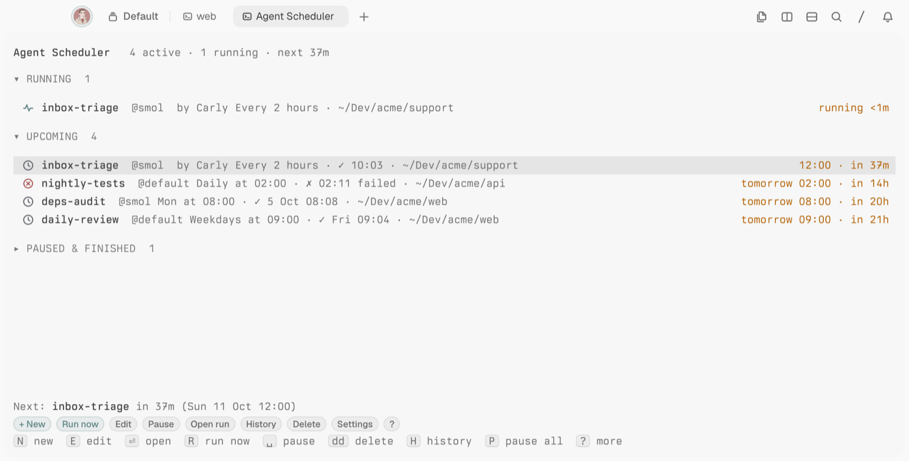
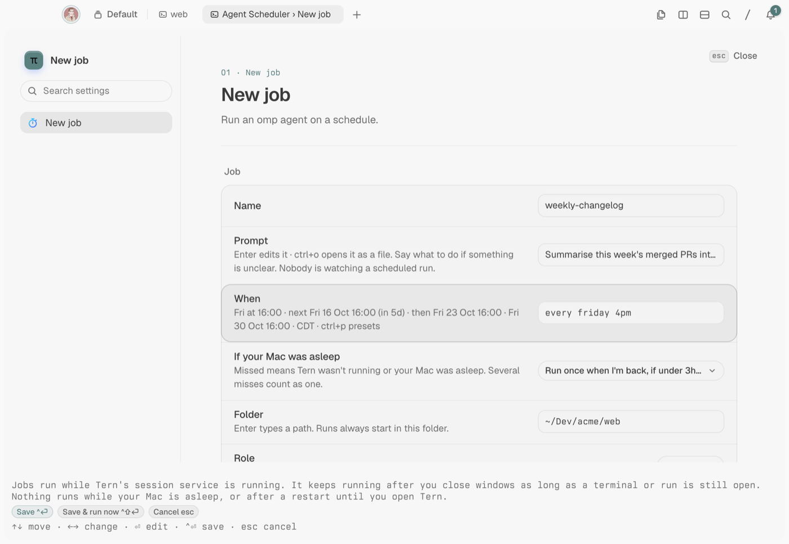
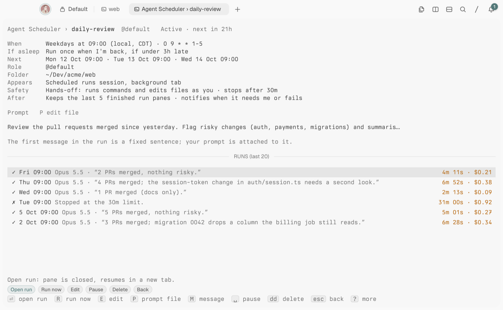

# Agent Scheduler _(tern-agent-scheduler)_

Scheduled [omp](https://github.com/can1357/oh-my-pi) agent runs for [Tern](https://stencil.so/tern): cron, presets, plain English or one-shot, each launched into its own tab while you keep working.



Write a prompt, pick a folder and say when ("weekdays 9am", "every 2h", `0 9 * * 1-5`). At that time Agent Scheduler starts omp in a background **Scheduled runs** session, watches it, and records how the run ended. Your focus never moves. The status line, toasts and desktop notifications tell you when something needs you or fails, and every run keeps its session so you can open it and carry on.

## Install

Built and tested on Tern 0.8.2. Runs on macOS or Linux (not Windows yet) and needs [omp](https://github.com/can1357/oh-my-pi). On Linux, desktop notifications use `notify-send` (libnotify).

```sh
tern plugin install github.com/bmanturner/tern-agent-scheduler
```

Press `ctrl+alt+shift+m` to open the manager (`ctrl+alt+shift+s` also works on macOS). With no jobs yet, it offers three examples you can save as they are or edit first. To update, run the install command again with `--force`; [CHANGELOG.md](CHANGELOG.md) lists what changed.

## Create a job

Press `n` in the manager, or `ctrl+alt+shift+j` anywhere. The folder starts as the focused pane's directory.



| Field | What it sets |
| --- | --- |
| Prompt | What the agent should do, in Markdown. `ctrl+o` opens it in an editor. |
| When | The schedule, with a preview of the next three runs. `ctrl+p` picks a preset. |
| If your computer was asleep | Run once when you're back if under 3 h late (default), always catch up, or skip. |
| Folder | Where every run starts. |
| Role | An omp model role such as `@default` or `@smol`, including your project's roles. |
| Approval | **Hands-off** (default), **Ask before commands** or **Ask for everything**. |
| Stop after | The time limit for one run, 5 minutes to 8 hours (default 30 minutes). |

`ctrl+enter` saves. `ctrl+shift+enter` saves and runs it once in front of you, so you can watch the first run.

> [!WARNING]
> Hands-off runs commands and edits files as you, with your credentials, while you're away. Only use it for prompts you'd trust unattended. The other two modes wait for you, and the run shows as **needs you** until you answer in its tab.

### Schedules

| You type | It means |
| --- | --- |
| `weekdays 9am`, `daily 09:00`, `hourly` | Every weekday / every day at 09:00; every hour |
| `mon,thu 18:30`, `every friday 4pm` | Those weekdays at that time |
| `monthly on the 1st 9am` | The 1st of each month |
| `every 15m`, `every 2h` | A fixed interval (5 minutes at least) |
| `in 30m`, `tomorrow 8am`, `2026-10-14 15:00` | Once |
| `0 9 * * 1-5`, `@daily` | Standard cron |
| `manual` | Only when you press Run now |

Times are local, and daylight-saving changes are handled.

Each run is told it is unattended and to end with a `RESULT:` line, which becomes the run's summary in the manager.

## The manager

Jobs are grouped into **Needs you**, **Needs fixing**, **Running**, **Upcoming** and **Paused & finished**. A run in progress shows its model, tool calls, cost and running time, with what it is doing now underneath.

Press `enter` on a job for its details: the prompt, a bar per recent run (red for failures), and each run's summary, duration and cost.



| Key | Does |
| --- | --- |
| `enter` | Open the job, or the tab of a run that needs you |
| `n` / `e` / `c` | New / edit / duplicate |
| `r` | Run now |
| `o` | Open the run's tab, or resume its session if the tab is gone |
| `space` | Pause or resume |
| `d` `d` | Delete (`u` undoes it for 10 s) |
| `?` | Every key |

From anywhere in Tern, the palette has **Agent Scheduler: Open manager** (`ctrl+alt+shift+m`), **New job…** (`ctrl+alt+shift+j`), **Run a job now…** (`ctrl+alt+shift+r`) and **Go to run that needs you** (`ctrl+alt+shift+a`).

### Carly

Ask Tern's assistant to create, list, run or pause jobs, for example *"Schedule a job called standup-notes in ~/Dev/app every weekday at 9am that summarises yesterday's commits."*

> [!NOTE]
> Jobs Carly creates are active immediately with the default approval (Hands-off). You get a toast and a desktop notification, and the manager marks them `by Carly`.

## Good to know

- **Jobs run while Tern's session service is running.** It keeps running after you close every window, as long as a terminal or a run tab is open. Nothing runs while your computer is asleep or after a restart until you open Tern; missed runs follow the job's **If your computer was asleep** setting.
- **A run waiting for your approval** is only noticed while a desktop Tern window is open.
- **In the browser (`tern web serve`) and on iPhone and iPad,** the manager works, but palette commands, the status line, notices of runs that need you and Carly's job tools need a desktop Tern window.
- **With several Tern windows,** runs go to the first window's **Scheduled runs** session.
- **Failures:** a run that hits its time limit is stopped. After three failures in a row the job pauses itself and tells you.
- **Finished run tabs:** the 5 most recent are kept and older ones are closed; their sessions can still be resumed.
- **Settings** (`,` in the manager) cover where runs appear, how many run at once (2), how many finished tabs to keep, and the late limit for missed runs. **Settings › Setup** checks that Tern and omp are found, and lets you set omp's path if it's somewhere unusual.

## Your data

Jobs, prompts and run history live in Tern's plugin data folder (**Settings › Setup › Open data folder**): `~/Library/Application Support/Tern/plugin-data/tern-agent-scheduler/` on macOS, `~/.config/tern/plugin-data/tern-agent-scheduler/` on Linux. If its files are ever damaged, the manager offers **Start fresh**.

> [!WARNING]
> Anything that can write to the data folder can create jobs or change what they run, including Hands-off ones. Keep it private to your user.

Agent Scheduler makes no network requests of its own; your runs use omp and whatever your prompts ask for.

To uninstall, run `tern plugin remove tern-agent-scheduler`. Delete the data folder to remove your jobs and history too.

## Develop

```sh
git clone https://github.com/bmanturner/tern-agent-scheduler
cd tern-agent-scheduler
tern plugin link .   # Tern reloads the plugin when a file changes
bun install && bun run test
```

The host half (`host.luau`, `lib/runner.luau`) owns the clock and launching; the window half (`window.luau`) adds palette commands, the status line, run observation and Carly. Design notes are in [`docs/design/`](docs/design/).

## License

[MIT](LICENSE)
