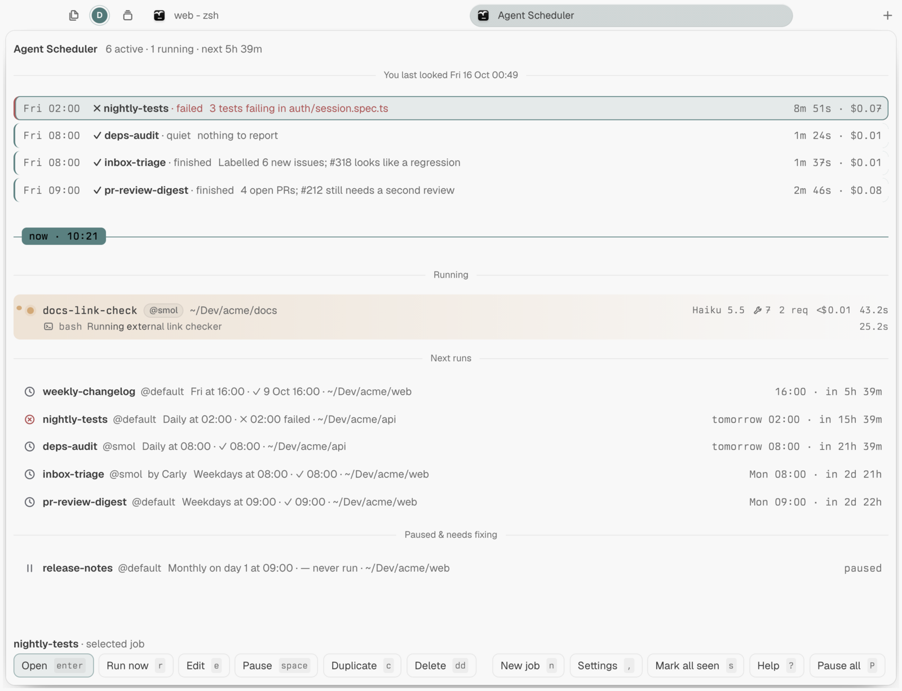
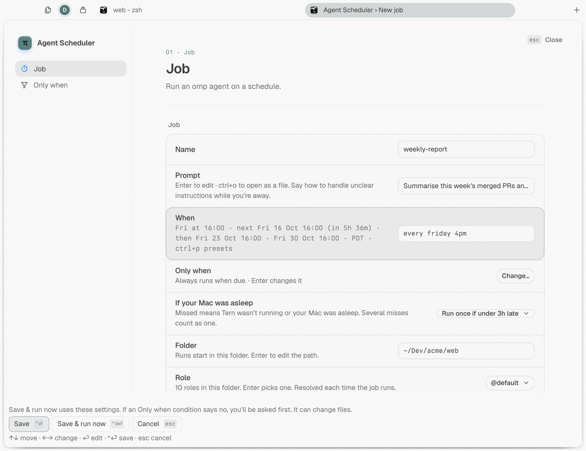
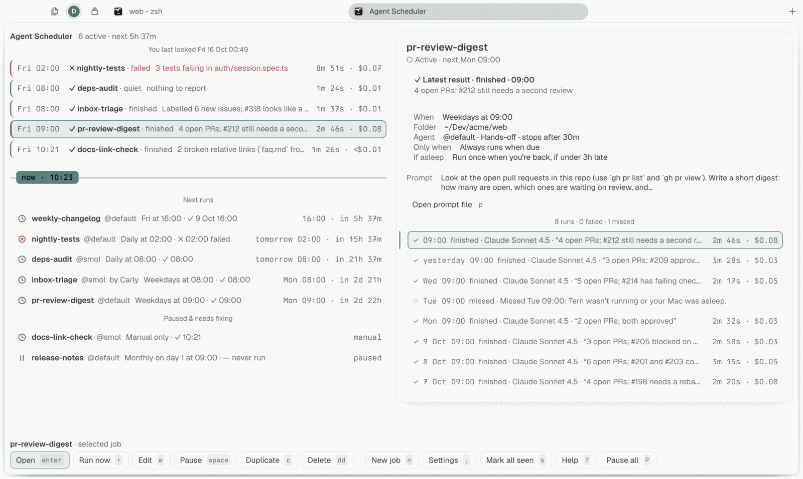

# Agent Scheduler _(tern-agent-scheduler)_

[](https://github.com/bmanturner/tern-agent-scheduler/actions/workflows/test.yml)

Scheduled [omp](https://github.com/can1357/oh-my-pi) agent runs for [Tern](https://stencil.so/tern): cron, presets, plain English or one-shot, each launched into its own tab while you keep working.

<picture>
  <source media="(prefers-color-scheme: dark)" srcset="docs/screenshots/manager-dark.png">
  
</picture>

Write a prompt, pick a folder and say when ("weekdays 9am", "every 2h", `0 9 * * 1-5`). At that time Agent Scheduler starts omp in a background **Scheduled runs** session, watches it, and records how the run ended. Your focus never moves. The status line, toasts and desktop notifications tell you when something needs you or fails, and every run keeps its session so you can open it and carry on.

A job can also wait for something worth doing: new commits on a branch, working hours, a daily run or spend limit, a script of yours, or a model's answer to a question you write. Runs that don't qualify are skipped quietly and noted in the job's history.

- [Install](#install)
- [Create a job](#create-a-job): [Schedules](#schedules), [Only when](#only-when)
- [The manager](#the-manager): [Settings](#settings), [Carly](#carly)
- [Good to know](#good-to-know)
- [Your data](#your-data)
- [Develop](#develop)
- [License](#license)

## Install

Built and tested on Tern 0.9.2. Runs on macOS or Linux (not Windows yet) and needs [omp](https://github.com/can1357/oh-my-pi). On Linux, desktop notifications use `notify-send` (libnotify).

> [!IMPORTANT]
> Jobs run while Tern's session service is running. It keeps running after you close every window, as long as a terminal or a run tab is open. Nothing runs while your computer is asleep, or after a restart until you open Tern; missed runs then follow each job's **If your Mac was asleep** setting.

```sh
tern plugin install github.com/bmanturner/tern-agent-scheduler
```

Press `ctrl+alt+shift+m` to open the manager (`ctrl+alt+shift+s` also works on macOS). With no jobs yet, it offers three examples to start from; Enter opens one in the New job form, and nothing is saved until you save it. To update, run the install command again with `--force`; [CHANGELOG.md](CHANGELOG.md) lists what changed.

## Create a job

Press `n` in the manager, or `ctrl+alt+shift+j` anywhere. The folder starts as the focused pane's directory.

<picture>
  <source media="(prefers-color-scheme: dark)" srcset="docs/screenshots/new-job-dark.png">
  
</picture>

| Field | What it sets |
| --- | --- |
| Prompt | What the agent should do, in Markdown. `ctrl+o` opens it in an editor. Images it links to are attached to every run. |
| When | The schedule, with a preview of the next three runs. `ctrl+p` picks a preset. |
| Only when | Conditions a due run must meet, or it's skipped. **Change…** opens the Only when page (see below). |
| If your Mac was asleep | Run once when you're back if under 3h late (default), run once however late, or skip missed runs. On Linux it reads *If your computer was asleep*. |
| Folder | Where every run starts. |
| Role | An omp model role such as `@default` or `@smol`, including your project's roles. |
| Approval | **Hands-off** (default), **Ask before commands** or **Ask for everything**. |
| Stop after | The time limit for one run, 5 minutes to 8 hours (default 30 minutes). |
| Quiet when nothing to report | Lets the agent end with `RESULT: [quiet]` when there's nothing worth reading; those runs are marked quiet in the history. |

Each run is told it is unattended and to end with a `RESULT:` line, which becomes the run's summary in the manager.

`ctrl+enter` saves. `ctrl+shift+enter` saves and runs it once in front of you, so you can watch the first run.

> [!WARNING]
> Hands-off runs commands and edits files as you, with your credentials, while you're away. Only use it for prompts you'd trust unattended. The other two modes wait for you, and the run shows as **needs you** until you answer in its tab.

### Schedules

| You type | It means |
| --- | --- |
| `weekdays 9am`, `daily 09:00`, `hourly` | Every weekday / every day at 09:00; every hour |
| `mon,thu 18:30`, `every friday 4pm` | Those weekdays at that time |
| `monthly on the 1st 9am` | The 1st of each month |
| `every 15m`, `every 2h` | A fixed interval (5 minutes at least) |
| `in 30m`, `tomorrow 8am`, `2026-10-14 15:00`, `at 2026-10-14 15:00` | Once |
| `0 9 * * 1-5`, `@daily` | Standard cron |
| `manual` | Only when you press Run now |

Times are local, and daylight-saving changes are handled.

### Only when

The form's second page, **Only when**, has one section per kind of condition. Each is off until you turn it on, and a due run starts only if every condition that's on says yes:

| Section | A due run starts only when |
| --- | --- |
| New commits | The branch you pick (or the folder's current one) has commits since the last successful run, optionally only in some folders. The agent gets the new commits in an attached `trigger.md`. |
| Time | It's on the days and between the times you pick, or, as quiet hours, outside them. |
| Limits | The job is under that many runs or that much spend today, or this week. |
| Your own check | Your script says yes. |
| Ask an AI | A model you pick reads your question, looks at the job's folder (read-only) and answers run. It's checked last, so it's only asked when everything else says yes. |

Once a condition is on, **Check now** at the top of the page runs every condition that's on without starting anything, and shows each answer in a **Right now** row under that condition.

For example, a nightly review that should only run after someone pushed: set **When** to `daily 02:00`, then on **Only when** turn on **New commits** and pick `main`. Nights with nothing new show up in history as one folded "Skipped N times" row.

A run that doesn't qualify is listed in the job's history as **skipped** with the reason; repeats fold into one row, and nothing notifies you. The first run of a new-commits job notes where the branch is and waits for something new. If a condition can't be checked (not a git folder, a script that fails), the run is blocked and you're told once; after three in a row the job pauses.

**Your own check** runs your script in the job's folder with a 30 s limit, passing a JSON file that describes the run as its argument:

| Your script | Means |
| --- | --- |
| Exits 0 | Run |
| Exits 1 | Skip |
| Exits with anything else | The run is blocked |
| Prints `REASON: …` | Shown in history |
| Prints `CONTEXT: …` lines | Passed to the agent |
| Prints `CURSOR: …` | Handed back to your script next time |

Saving the job approves the script as it is then; if it changes, runs are blocked until you open the job and save again. Carly can set every condition except your own check.

**Ask an AI** is for judgement calls a script can't easily make, such as *"Are there open pull requests that still need a review?"* Before a due run, omp runs in the background with your question, the job's name, folder, time and last run, and whatever the other conditions found (for example the new commits).

- It can read and search files (and read web pages) but can't change anything or run commands.
- It has 60 s to end with `ANSWER: run` or `ANSWER: skip` and a reason. A skip is listed in history with that reason; a run hands the reason to the job's agent in `trigger.md`. An answer it can't give blocks the run, like a failing script.
- Each check is one model call (about $0.001 with `@smol`) and counts toward Limits. **Check now** asks it too.

**Run now** checks the conditions first and asks **Run anyway?** when one says no. `i` checks them without running anything.

## The manager

The default **Timeline** lists the results since you last looked, a **Now** rule, then each active job at its next run; paused, manual-only and broken jobs sit at the bottom. A run in progress sits on the Now rule, which only appears when something is above it or on it. When nothing is new, one line says so ("Nothing new since 08:00."), and on a first visit it names the first run ("Nothing has run yet. pr-review-digest runs first, 18:00 (in 9h 52m)."). More than eight new results fold into one summary per job, with failures still listed one by one.

At 150 columns or wider, a job's details sit beside the list and follow the selection; Enter moves to its runs and Escape returns to the jobs. In narrower panes, Enter opens the details full-width. **Settings › Display › Layout** brings back the **Classic job list**, grouped into Needs you, Needs fixing, Running, Upcoming and Paused & finished.

<picture>
  <source media="(prefers-color-scheme: dark)" srcset="docs/screenshots/job-details-dark.png">
  
</picture>

Job details show the latest result, the job's settings and prompt, and one line per run with its outcome, duration and cost; failed and missed runs are counted separately. **Settings › Display › Time format** picks **Automatic** (your system's 12- or 24-hour preference, else 24-hour), **12-hour** or **24-hour** for every time Agent Scheduler shows, including notifications, the status line and Carly.

New results fade three seconds after you open the manager; choose **Stay until marked seen** under **Settings › Display › New results** to keep them highlighted. Press `s` or click **Mark all seen** to clear them; the button and key only appear when there is something to mark. A failure marker stays on the job until its next success.

| Key | Does |
| --- | --- |
| `enter` | Open the job, or the tab of a run that needs you |
| `n` / `e` / `c` | New / edit / duplicate |
| `r` | Run now |
| `i` | Check the job's conditions now |
| `o` | Open the run's tab, or resume its session if the tab is gone |
| `space` | Pause or resume |
| `d` `d` | Delete (`u` undoes it for 10 s) |
| `s` | Mark all results seen |
| `?` | Help: every key, and when jobs run |

From anywhere in Tern, the palette has **Agent Scheduler: Open manager** (`ctrl+alt+shift+m`), **New job…** (`ctrl+alt+shift+j`), **Run a job now…** (`ctrl+alt+shift+r`) and **Go to run that needs you** (`ctrl+alt+shift+a`).

### Settings

Press `,` in the manager, or pick **Agent Scheduler: Settings** in the palette.

| Section | What's there |
| --- | --- |
| Status | Whether Agent Scheduler is ready to run jobs, and what to fix if it isn't. **Check again** checks again. |
| Display | Time format, layout, and how new results are shown. |
| Where runs start | Which session runs appear in, its name, and whether it comes to the front. |
| Limits | How many jobs run at once (2), how many finished run tabs to keep (5), and how late a missed run may still start. |
| Setup | omp's path, if it's somewhere unusual, and the data folder. |

### Carly

Ask Tern's assistant to create, list, run or pause jobs, or to check a job's conditions, for example *"Schedule a job called standup-notes in ~/Dev/app every weekday at 9am that summarises yesterday's commits, only when there are new commits on main."* Carly can also turn on **Quiet when nothing to report**.

With each request, Agent Scheduler tells Carly to use it, rather than her own scheduled tasks, for agent work in a folder that repeats or takes longer than three minutes, and to confirm a job's details with you before creating it.

> [!NOTE]
> Jobs Carly creates are active immediately with the default approval (Hands-off), and Carly can't edit or delete them; change or delete them in the manager. You get a toast and a desktop notification, and the manager marks them `by Carly`.

## Good to know

- **A run waiting for your approval** is only noticed while a desktop Tern window is open.
- **In the browser (`tern web serve`) and on iPhone and iPad,** the manager works, but palette commands, the status line, notices of runs that need you and Carly's job tools need a desktop Tern window.
- **With several Tern windows,** runs go to the first window's **Scheduled runs** session.
- **Remote hosts:** jobs run on the machine the plugin is installed on. To schedule runs on a remote host you've attached in Tern, install the plugin there too (run the install command in a pane on that host); it keeps its own jobs and manager, which **Open manager** and **New job…** open while you're in one of that host's sessions. This computer's status line, notifications, Carly and the other palette commands cover only this computer's jobs, and a run on the remote host that waits for your approval isn't noticed.
- **Failures:** a run that hits its time limit is stopped. After three failures in a row the job pauses itself and tells you.
- **Finished run tabs:** the 5 most recent are kept and older ones are closed (**Settings › Limits** changes the number); their sessions can still be resumed.

## Your data

Jobs, prompts and run history live in Tern's plugin data folder (**Settings › Setup › Data folder**): `~/Library/Application Support/Tern/plugin-data/tern-agent-scheduler/` on macOS, `~/.local/state/tern/plugin-data/tern-agent-scheduler/` on Linux. If its files are ever damaged, the manager offers **Start fresh**.

> [!WARNING]
> Anything that can write to the data folder can create jobs or change what they run, including Hands-off ones. Keep it private to your user.

Agent Scheduler makes no network requests of its own; your runs use omp and whatever your prompts ask for.

To uninstall, run `tern plugin remove tern-agent-scheduler`. Delete the data folder to remove your jobs and history too.

## Develop

```sh
git clone https://github.com/bmanturner/tern-agent-scheduler
cd tern-agent-scheduler
tern plugin link .   # Tern reloads the plugin when a file changes
bun install && bun run test
```

The host half (`host.luau`, `lib/runner.luau`) owns the clock and launching, and `lib/cond_eval.luau` checks a job's Only when conditions; the window half (`window.luau`) adds palette commands, the status line, run observation and Carly. The manager is a block (`blocks/manager.luau`, with `lib/mgr_*.luau` and `manager.css`). Design notes are in [`docs/design/`](docs/design/).

Bug reports and pull requests are welcome in [GitHub issues](https://github.com/bmanturner/tern-agent-scheduler/issues). CI runs `bun run test` on every pull request.

## License

[MIT](LICENSE)
