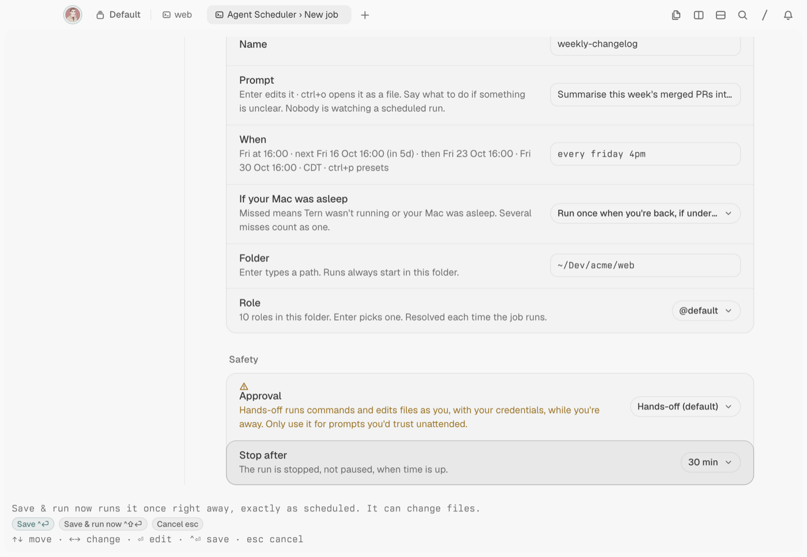

# Agent Scheduler _(tern-agent-scheduler)_

Scheduled [omp](https://github.com/can1357/oh-my-pi) agent runs for [Tern](https://stencil.so/tern): cron, presets, plain English or one-shot, each launched into its own tab while you keep working.


Write a prompt, pick a folder and say when ("weekdays 9am", "every 2h", `0 9 * * 1-5`). At that time the plugin starts omp in a **Scheduled runs** session in the background. It watches the agent and records how each run ended: finished, failed, timed out, or waiting for you. Your focus never moves. A status-line segment, toasts and macOS notifications tell you what happened. Every run keeps its session, so you can open it and carry on.

## Contents

- [Install](#install)
- [Usage](#usage)
- [How a run works](#how-a-run-works)
- [When jobs run](#when-jobs-run)
- [Settings](#settings)
- [Your data](#your-data)
- [Requirements](#requirements)
- [Uninstall](#uninstall)
- [Develop](#develop)
- [License](#license)

## Install

```sh
tern plugin install github.com/bmanturner/tern-agent-scheduler
```

- Update: run the same command with `--force`.
- From a local clone: `tern plugin install ./tern-agent-scheduler`.

Then press `ctrl+alt+shift+s`, or run **Agent Scheduler: Open manager** from the palette. With no jobs yet, the manager offers three example jobs you can save as they are or edit first.

## Usage

### Create a job

Press `n` in the manager, or `ctrl+alt+shift+j` anywhere. The folder starts as the focused pane's directory.


| Row | What it sets |
| --- | --- |
| Name | How the job appears in lists, tabs and notifications. Up to 40 characters. |
| Prompt | What the agent should do, in Markdown. `ctrl+o` opens it as a file in Tern's editor. |
| When | The schedule. The row previews the next three runs as you type. `ctrl+p` picks a preset. |
| If your Mac was asleep | Run once when you're back if the run is less than 3 h late (the default), always catch up, or skip. |
| Folder | Where the run starts. Each run starts here. |
| Role | An omp model role such as `@default` or `@smol`, read from omp for that folder, so project roles appear too. |
| Approval | **Hands-off** (default), **Ask before commands** or **Ask for everything**. |
| Stop after | The time limit for one run, from 5 minutes to 8 hours. The default is 30 minutes. |
| Active | Off keeps the job but never schedules it. |

`ctrl+enter` saves. `ctrl+shift+enter` saves and runs it now in front of you, so you can see any permission prompts the first time.

> [!WARNING]
> Hands-off runs commands and edits files as you, with your credentials, while you're away. Only use it for prompts you'd trust unattended. The other two approval modes stop and wait for you, and the run shows as **needs you** until you answer in its tab.



### Schedules

Type a schedule the way you'd say it. The form shows how it read your text before you save.

| You type | It means |
| --- | --- |
| `weekdays 9am`, `every weekday at 9am` | Monday to Friday at 09:00 |
| `daily 09:00`, `hourly` | Every day at 09:00; every hour on the hour |
| `mon,thu 18:30`, `every friday 4pm` | On those weekdays at that time |
| `monthly on the 1st 9am` | The 1st of each month at 09:00 |
| `every 15m`, `every 2h` | A fixed interval. The shortest is 5 minutes. |
| `in 30m`, `tomorrow 8am`, `2026-10-14 15:00` | Once |
| `0 9 * * 1-5`, `@daily` | Standard 5-field cron |
| `manual` | Only when you press Run now |

Times are your Mac's local time. Daylight-saving changes are handled: a 02:30 run on the spring-forward day runs at 03:00, and an hourly job doesn't run twice in the repeated hour.

### The manager

The list groups jobs into **Needs you**, **Needs fixing**, **Running**, **Upcoming** and **Paused & finished**. Each row shows the role, the schedule, the last result, the folder and the next run. Jobs Carly created say `by Carly`.

Press `enter` on a job for its details and run history: the model each run used, its `RESULT:` summary, how long it took and what it cost.


| Key | Does |
| --- | --- |
| `j` `k` / arrows, `g` `G` | Move |
| `enter` | Open the job; on a run that needs you, open its tab |
| `n` / `e` / `c` | New job / edit / duplicate |
| `r` | Run now |
| `space` | Pause or resume the job |
| `d` `d` | Delete (any other key cancels); `u` restores the job and its run history within 10 s |
| `h` | History |
| `o` | Open the run: focus its tab, or resume its session in a new tab if the pane is gone |
| `x` | Stop the running run |
| `p` | Edit the prompt file |
| `a` | Jump to a run that needs you |
| `P` (shift+p) | Pause or resume every job |
| `,` | Settings |
| `?` | All keys |

Most actions also have a button in the bar under the list.

### Palette commands

| Command | Keys |
| --- | --- |
| Agent Scheduler: Open manager | `ctrl+alt+shift+s` |
| Agent Scheduler: New job… | `ctrl+alt+shift+j` |
| Agent Scheduler: Run a job now… | `ctrl+alt+shift+r` |
| Agent Scheduler: Go to run that needs me | `ctrl+alt+shift+a` |

### Status line and notifications

The status line shows the most important thing at the time, such as `scheduler stalled · last tick 4m ago`, `1 needs you · deps-audit`, `nightly-tests failed`, `daily-review · 4m` or `next: inbox-triage in 38m`. Clicking it opens the manager, or the run that needs you.

Windows show toasts when a run needs you, fails, is blocked or gets paused after repeated failures. Agent Scheduler itself posts a macOS banner through `osascript`, even with every window closed. If you don't see them, allow notifications in System Settings › Notifications. Banners are sent when:

- a run needs you, with one reminder if it's still waiting 30 minutes later;
- a run fails, times out or is blocked, once per streak of failures until a run succeeds;
- a job is paused after repeated failures;
- Carly creates a job.

Successful runs stay quiet.

### Carly

Agent Scheduler gives Carly, Tern's assistant, five functions:

| Function | Does |
| --- | --- |
| `job_add(name, prompt, when, folder?, role?)` | Creates the job and schedules it at once. |
| `jobs_list()` | Lists jobs with their schedule, next run, role, folder and state. |
| `job_run(name)` | Runs a job now. |
| `job_pause(name, paused)` | Pauses or resumes one job. |
| `jobs_pause_all(paused)` | Pauses or resumes every job. |

Ask *"Schedule a job called standup-notes in ~/Dev/app every weekday at 9am that summarises yesterday's commits"* and Carly creates it with a toast: **Carly scheduled standup-notes**.

> [!NOTE]
> Carly-created jobs are active immediately and use the default approval, Hands-off unless you changed `defaults.approval` in `settings.json`. Carly's reply states the approval the job actually got. Agent Scheduler shows a toast and a macOS notification, and the manager marks the job `by Carly`.

`name` matches case-insensitively: an exact name first, then a unique prefix of 3 or more characters. `paused` must be `true` or `false`.

## How a run works

1. At the scheduled time, a clock in Tern's background session service checks the job: is the folder there, does the role exist, is another run of this job still going, are too many jobs already running?
2. It writes the prompt to a file and opens a new tab in the **Scheduled runs** session with `omp --model @role --approval-mode … --max-time …`. The prompt is attached to the first message as that file, so quotes, newlines and emoji in your prompt never pass through a shell.
3. omp is also told the run is unattended: work on its own, don't ask questions unless truly blocked, and end with a `RESULT:` line. That line becomes the run's summary.
4. The tab is named `⏲ <job name>`. Your current tab and focus don't change.
5. Agent Scheduler records how the run ended, reads its cost from the omp session file and keeps the pane open. It keeps the 5 most recent finished panes and closes older ones. Their sessions stay, and **Open run** resumes them.

A run that hits its time limit is stopped and marked timed out. After three failures in a row the job pauses itself and tells you once.

## When jobs run

Jobs run while Tern's session service is running. It keeps running after you close every window, as long as a terminal or a run pane is still open.

- Nothing runs while your Mac is asleep, or after a restart until you open Tern. Missed runs follow the job's **If your Mac was asleep** setting, and several misses count as one.
- With no window open, runs still start and finish. Agent Scheduler only notices a run waiting for your approval while a window is open.
- If you have several Tern windows, runs go to the first window's **Scheduled runs** session.

**Settings › Setup** checks all of this: the `tern` and `omp` binaries (with an **omp path** row if omp is somewhere unusual), the scheduler heartbeat, and whether anything is keeping the service alive.

## Settings

Press `,` in the manager.

| Setting | Default |
| --- | --- |
| Where runs appear | A **Scheduled runs** session, in a background tab. Or a background tab in the current session. |
| Bring to front when it starts | Off |
| Run session name | `Scheduled runs` |
| Finished run panes to keep | 5 (1–20) |
| Jobs running at once | 2. A run over the limit waits up to 10 minutes, then is skipped. |
| Late limit for missed runs | 3 h |

## Your data

Everything lives in Tern's plugin data folder (**Settings › Setup › Open data folder**), on macOS `~/Library/Application Support/Tern/plugin-data/tern-agent-scheduler/`:

| Path | Holds |
| --- | --- |
| `jobs.json`, `state.json`, `settings.json` | Job definitions, schedule state and settings, each with a `.bak` copy |
| `prompts/<job>.md` | Each job's prompt |
| `ledger/<job>.jsonl` | Run history (the newest 50 runs per job, up to 90 days) |
| `runs/<job>/<run>/` | The prompt, instructions and omp session of each run |
| `cache.json` | Resolved `tern` and `omp` paths and each folder's omp roles. Safe to delete. |
| `snapshot.json` | What the host publishes for the status line, toasts and Carly |
| `events.jsonl` | A short log of the scheduler's own events, such as gaps while it wasn't running |
| `intents/`, `replies/` | Short-lived messages between the windows and the clock |
| `drafts/` | Prompt files opened with `ctrl+o` while writing a job |
| `trash/` | The prompt of each deleted job, kept 30 days |
| `*.corrupt-<time>` | A copy of a data file that couldn't be read |

If `jobs.json`, `state.json` or `settings.json` is damaged and its `.bak` can't restore it, jobs pause and the manager offers **Start fresh** (sets the damaged files aside as `.corrupt-<time>` copies) or **Open data folder** to repair them by hand.

> [!WARNING]
> The data folder is trusted. Anything that can write files there can create jobs or change what an existing job runs, including Hands-off ones. Keep it private to your user.

Agent Scheduler makes no network requests of its own. Your runs use omp and whatever your prompts ask for.

## Requirements

- Tern 0.7.2 or later, on macOS.
- omp. Agent Scheduler checks each candidate with `--version`, in this order: the **omp path** set in Settings › Setup, the Tern-managed omp, `/opt/homebrew/bin`, your login shell's `PATH` (read as an interactive shell, so `.zshrc` and `.bashrc` count), `~/.local/bin`, `~/.bun/bin` and `/usr/local/bin`.

## Uninstall

```sh
tern plugin remove tern-agent-scheduler
```

Your jobs and run history stay in the data folder above. Delete it to remove them.

## Develop

Tests need [Bun](https://bun.sh).

```sh
git clone https://github.com/bmanturner/tern-agent-scheduler
cd tern-agent-scheduler
tern plugin link .   # Tern reloads the plugin when a file changes
bun install
bun run test         # cron/DST engine and runner tests, against golden outputs
```

The host half (`host.luau`, `lib/runner.luau`) owns the clock, the job files and launching. The window half (`window.luau`) adds the palette commands, the status line, toasts, run observation and Carly functions. The two halves talk through files in the data folder. The design notes are in [`docs/design/`](docs/design/), and the platform checks behind them are in [`docs/verification-m1.md`](docs/verification-m1.md).

## License

[MIT](LICENSE)
