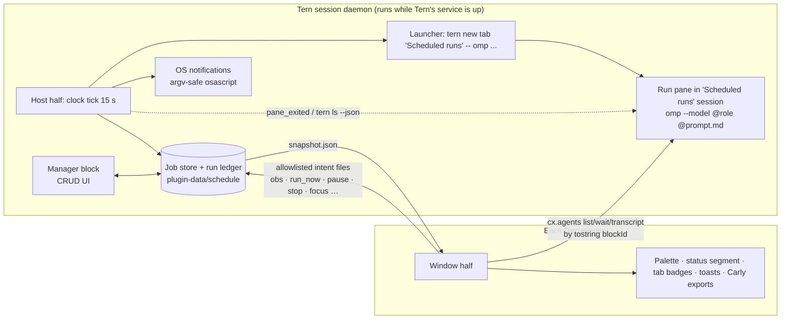

# Schedule (`tern-schedule`): design dossier

Status: design proposal, 2026-10-11. Target: Tern 0.7.2, omp 18.9.1. Plugin id `schedule`. Nothing is implemented yet except the tested Luau engine prototypes in [`design/engine-src/`](design/engine-src/).

Schedule is a Tern plugin that lets you create, edit, pause and delete scheduled omp agent jobs from a manager screen inside Tern: a cron-style or plain-language schedule, a prompt, an omp role (default `@default`), a working folder, and where the run's pane appears. When a job is due, the plugin starts a real omp agent in a Tern pane, tracks whether it is working, needs you, or finished, and tells you. It needs no omp extension and no external scheduler.

If anything in a copied document conflicts with another, [`design/decisions.md`](design/decisions.md) wins. Claims marked `[INFERENCE]` or "unverified" have not been observed on this machine.

## 1. What it takes (short answer)

Feasible as one Tern plugin with a host half (runs in Tern's session daemon) and a window half (runs in each Tern window). No omp extension is required for v1 ([architecture.md](design/architecture.md#decision)).

The enablers, each observed on this machine (section 5):

1. **A host-half clock in the session daemon.** The daemon runs one host VM per plugin, so there is exactly one clock: no duplicate firing across windows and no leader lease. It survives closing every window while a pane is still live.
2. **The `tern new` CLI as launcher.** Called from the host half with an absolute `tern` path, `tern new tab|session "Scheduled runs" --json --cwd <dir> --keep-open -- omp ...` does not change the shown tab or focus, works with zero windows attached (it needs a session to exist, so the launcher creates one first), and returns the daemon block id.
3. **Observation through `cx.agents` addressed by `tostring(blockId)`.** The string form of the daemon block id is the only id that works for `wait`, `transcript`, `stop`, `cx.session:resolve`. The window half polls it and reports raw state samples to the host.
4. **omp flags that make a run self-contained:** `--model @role`, `--approval-mode`, `--max-time`, `--session-dir`, `--append-system-prompt`, `--config` (a per-run overlay) ([research/omp-capabilities.md](research/omp-capabilities.md)).
5. **Prompt as a file, never as argv.** The prompt travels as a per-run snapshot attached with `@<run>/prompt.md`, so no user text can be shell-interpreted.
6. **A cron engine that works without `TZ` support:** local-time-only cron/NL/one-shot grammar, tested under a fake America/Chicago clock across both DST transitions ([engine.md §8](design/engine.md)).

Hard constraints (the user-facing versions are in section 7):

- Jobs fire only while Tern's session service is running and the Mac is awake. After a restart nothing fires until Tern is opened.
- Times use the Mac's local time zone; no per-job time zones (Luau has no IANA database).
- With no Tern window open, "needs you" cannot be observed (`cx.agents` is window-only); host-visible failures still notify.
- With two windows open, whether sessions are daemon-wide or per window is unverified (gate V26).
- Whether the production daemon stays alive with zero windows is unverified (gate V28); it was observed only on an isolated daemon.

Milestone sizes (section 8): a time-boxed M1 gate spike, then M1 (the minimum lovable loop), M2 (depth), M3 (reach). The sources give no effort estimates beyond that.

## 2. What the user gets

This is the M1 experience ([ux.md](design/ux.md) owns the details).

**Palette commands (group "Schedule").** Open manager (`ctrl+alt+shift+s`), New job (`ctrl+alt+shift+j`), Run a job now (`ctrl+alt+shift+r`), Go to run that needs me (`ctrl+alt+shift+a`, available only while a run needs you). Palette commands never create or change jobs themselves; "New job" opens the manager with a draft ([ux.md §2.2](design/ux.md#22-palette-commands-group-schedule)).

**The manager block.** One tab named "Schedule", grouped Needs you, Running, Upcoming, Paused & finished, with a detail/history view per job. Wide layout (100 cells):

```
┌ Schedule ─────────────────────────────────────────────────────────────────────────────────────────────┐
│  Schedule                                              4 active · 1 running · 1 needs you · next 14h    │
│                                                                                                        │
│  NEEDS YOU  1                                                                                          │
│▌ ⚠ deps-audit  @default   Waiting for approval: "Run `npm audit fix`?" · ~/Dev/app           waiting 6m │
│                                                                                                        │
│  RUNNING  1                                                                                            │
│  ● weekly-notes  @smol    Fridays 17:00 · ✓ Fri 17:04 $0.08 · ~/Dev/notes                  running 4m │
│                                                                                                        │
│  UPCOMING  3                                                                                           │
│  ◷ daily-review  @smol    Weekdays 09:00 · ✓ Fri 09:03 $0.42 · ~/Dev/app          Mon 09:00 · in 14h │
│  ✗ nightly-tests  @task   Daily 02:00 · ✗ Sat 02:00 failed · ~/Dev/api                Mon 02:00 · in 7h │
│  ◷ deps-audit  @default   Mondays 08:00 · ⚠ waiting · ~/Dev/app                        Mon 08:00 · in 13h │
│                                                                                                        │
│  ▸ PAUSED & FINISHED  2                                                                                │
│  ▸ RECENT RUNS  10                                                                                     │
│                                                                                                        │
├────────────────────────────────────────────────────────────────────────────────────────────────────────┤
│  Next: daily-review in 14h (Mon 12 Oct 09:00)           [Open run] [Edit] [Pause] [History] [Delete]   │
│  n new  e edit  ⏎ open  r run now  ␣ pause  dd delete  h history  P pause all  ? more                  │
└────────────────────────────────────────────────────────────────────────────────────────────────────────┘
```

(Wireframe copied from [ux.md §3.5](design/ux.md#35-wireframes); a 56-cell narrow variant and the detail/history view are there too.)

**The nine-row form** (Name, Prompt, When, If your Mac was asleep, Folder, Role, Approval, Stop after, Active), copied from [ux.md §4.11](design/ux.md#411-form-wireframe-m1-9-rows):

```
┌ Schedule › New job ────────────────────────────────────────────────────────────────────────────────────┐
│  New job                                                                       3 changed from default  │
│  Run an omp agent on a schedule.                                                                       │
│                                                                                                        │
│  JOB                                                                                                   │
│  Name           daily-review▏                                                                          │
│  Prompt         Review yesterday's commits and open PRs in this repo. Summarize what           ⏎ edit  │
│                 changed, flag risky changes, and list what needs a human decision.            ^O file  │
│                 Say what to do if something is unclear. Nobody is watching a scheduled run.            │
│  When           weekdays 12:30                                                             ^P presets  │
│                 Weekdays at 12:30 · next Mon 12 Oct 12:30 (in 17h)                                     │
│                 then Tue 13 Oct 12:30 · Wed 14 Oct 12:30 · Thu 15 Oct 12:30 · PDT                      │
│  If your Mac was asleep   Run once when I'm back, if under 3h late ▾                                   │
│                 Missed means Tern wasn't running or your Mac was asleep. Several misses count as one.  │
│  Folder         ~/Dev/app                                                                      ⏎ pick  │
│                 git · main · 3 uncommitted files. The agent works in this checkout.                    │
│  Role           @default ▾                                                                             │
│                 claude-opus-5-5 · medium. Costs more than @smol. Resolved each time the job runs.      │
│                                                                                                        │
│  SAFETY                                                                                                │
│  Approval       Ask before commands ▾                                                                  │
│                 If a run stops to ask, it shows up under Needs you.                                    │
│  Stop after     30 min ▾                                                                               │
│                                                                                                        │
│  Active         [on]                                                                                   │
├────────────────────────────────────────────────────────────────────────────────────────────────────────┤
│  Jobs run while Tern's session service is running. It keeps running after you close windows as long as │
│  a terminal or run is still open. Nothing runs while your Mac is asleep, or after a restart until you  │
│  open Tern.                                                                                            │
│  [ Save ^⏎ ]  [ Save & run now ^⇧⏎ ]  [ Cancel esc ]                     ↑↓ move · ←→ change · ⏎ edit  │
└────────────────────────────────────────────────────────────────────────────────────────────────────────┘
```

**Schedule input.** One text field with a live three-line preview ([ux.md §4.3](design/ux.md#43-when-schedule-input-presets-preview)). Accepted:

| Kind | Examples |
|---|---|
| Presets | `hourly`, `daily 9am`, `weekdays 09:00`, `weekly on friday 4pm`, `monthly on the 1st 9am`, `mon,thu 18:30` (also `ctrl+p` picker) |
| Plain language intervals | `every 2h`, `every 30m` (minimum 5 min) |
| One-shot | `in 30m`, `tomorrow 8am`, `at 2026-10-14 15:00` |
| Cron, 5 fields | `0 9 * * 1-5` (echoed back as "Reads as: at 09:00, Monday to Friday") |
| Manual | `manual` (run-now only) |

The preview shows next fire times, the Mac's time zone, the cron "date OR weekday" trap, and DST gap/overlap behavior.

**Role picker.** `@default` is the default for new jobs. Roles are read per job folder from omp config (`omp config get modelRoles --json`), cached, and shown with the model behind each ([ux.md §4.4](design/ux.md#44-role-m1)). A role missing from the folder's config blocks the run with an explicit reason; an unreadable role list lets the run proceed and records `role_unverified`.

**Folder.** Pre-filled from the focused local pane's cwd; otherwise empty and required. No silent `$HOME` fallback; explicitly choosing `~` adds `--allow-home`. Paths containing `' " \ $` ` ! newline` are rejected at save ([ux.md §4.5](design/ux.md#45-folder-m1)).

**Placement and Bring to front.** M1 offers two placements: a dedicated "Scheduled runs" session (default; a background tab per run) and a background tab in the session you are in, plus a "Bring to front when it starts" switch. Run now and Save & run now always come to front. Split and picture-in-picture are M2 ([ux.md §4.6](design/ux.md#46-where-runs-appear-placement-and-focus-m1-as-settings-per-job-m2)).

**Run lifecycle** ([ux.md §5](design/ux.md#5-run-lifecycle-ux)):

1. **Fire.** The host clock sees a due slot and launches the run; the default placement shows no toast and does not change your view or focus.
2. **Scheduled runs session.** A tab named `⏲ daily-review` appears in that session.
3. **Status segment.** One segment per window, precedence: scheduler stalled, setup needed, needs you, failed (unseen), running, next run ("next: daily-review in 14h").
4. **Needs you.** If omp stops to ask, the run moves to Needs you with a toast, a status segment and a "Go to run that needs me" command (window required, section 7).
5. **Finished.** The agent is asked to end with a `RESULT:` line; that line becomes the summary; `RESULT: FAILED - ...` is recorded as failed. Cost comes from the session file (labeled approximate when the file is larger than the 1 MiB tail read).
6. **Open run.** Focuses the kept pane; if it was closed, opens a new tab running `omp --session-dir <run>/session --resume <session>`.

**History with reasons.** Runs that never started (blocked, skipped, missed) are history rows with a sentence, never silent: "Skipped: the previous run was still going."; "Missed Mon 09:00: 13h late, over the 3h limit."; "Caught up: missed Tue 09:00 while Tern was closed; ran once at 09:42."

**Notifications.** In-Tern toasts (window side) plus macOS notifications sent only by the host, deduplicated, for needs-you, failures and blocked runs; a first-ever scheduled run toasts once; first load shows one "Schedule is ready" toast.

### Requirements map

| You asked for | Where it is met |
|---|---|
| Menu to CRUD scheduled prompts | Manager block: list, detail, form; Run now, Pause/Resume, Delete (two-press + undo), Duplicate, Pause all ([ux.md §3-4](design/ux.md)) |
| Cron-style schedule | When field: cron, presets, intervals, one-shot, manual; live preview ([engine.md §3](design/engine.md), [ux.md §4.3](design/ux.md#43-when-schedule-input-presets-preview)) |
| Prompt | Multi-line editor in the form, or a managed `prompts/<id>.md` opened with `ctrl+o` (M1 gate decides the fallback, section 8) |
| omp role, default `@default` | Role row; stored bare, passed as `--model @default` ([decisions R16](design/decisions.md#3-product)) |
| Configurable cwd | Folder row, pre-filled from the focused pane; validated; no `$HOME` fallback (R17) |
| Configurable placement of the agent's block | Scheduled runs session or background tab, plus Bring to front (M1); split and picture-in-picture (M2) ([launch.md §4](design/launch.md)) |
| Anything else good for UX | Needs-you triage, status segment, history with reasons, catch-up policy, Setup check, honest-limits copy, notifications, empty state with examples, Open run |

## 3. How it works

Details: [architecture.md](design/architecture.md).



### Responsibilities (condensed; full table in [architecture.md](design/architecture.md#responsibilities))

| Concern | Host half (daemon) | Window half |
|---|---|---|
| Clock, due slots, missed/overlap/catch-up | Single writer | none |
| Job and run storage | Writes everything | Reads `snapshot.json`; writes intent files only |
| Launching and stopping runs | `tern new`, `tern close` via `tern.process.run` | none |
| Liveness | `pane_exited`, `tern ls --json` per tick | none |
| Agent state, last message | none (`cx.agents` is window-only) | `cx.agents` by `tostring(block)`; raw samples sent as `obs` intents |
| Manager UI | The only place jobs and settings are created or changed | Palette opens it via `cx:new_block` with draft args |
| OS notifications | Single writer, deduped | none |
| Status segment, toasts, badges | none | Yes |

### Launcher argv for a typical job

Job `daily-review` (`@default`, approval `write`, 30 min), session already exists, fire slot 1791727200 ([launch.md §2.5 A](design/launch.md#25-three-worked-examples)). `D` is `~/Library/Application Support/Tern/plugin-data/schedule`; ids are `j_` + 8 chars and `r_<job8>_<slot>`:

```lua
local R = D.."/runs/j_k3x9a2bc/r_k3x9a2bc_1791727200"
{ TERN, "new", "tab", "Scheduled runs", "--json", "--cwd", "/Users/bfturner/Dev/app", "--keep-open", "--",
  OMP, "--model", "@default", "--approval-mode", "write", "--max-time", "1800",
  "--session-dir", R.."/session",
  "--append-system-prompt", R.."/preamble.md",
  "--config", R.."/omp.yml",
  "@"..R.."/prompt.md",
  "Run the scheduled job described in the attached file." }
```

`TERN` and `OMP` are absolute paths (host `PATH` is `/usr/bin:/bin:/usr/sbin:/sbin`; omp is resolved Tern-managed first and version-checked, [launch.md §1](design/launch.md#1-binary-resolution)). Tern joins argv into a `/bin/zsh -l -c` string, which is why the job name, prompt and any user text never appear in argv. The exact quoting of spaced paths is gate V1.

### Storage layout (`plugin-data/schedule/`, [engine.md §2](design/engine.md))

```
<data>/
  kv.json                 Tern-owned; host writes one key "hot" (rev, counters, heartbeat)
  snapshot.json           host -> window read model
  settings.json (+.bak)   global settings, first-run flags
  cache.json              regenerable: binary paths/versions, role lists per cwd
  jobs.json     (+.bak)   job definitions
  state.json    (+.bak)   runtime state, in-flight run ids
  prompts/<job id>.md     managed prompt text (source of truth)
  drafts/<draft id>.md    unsaved New-job prompts
  ledger/<job id>.jsonl   run ledger, one record per run
  runs/<job id>/<run id>/ prompt.md, preamble.md, omp.yml, session/
  events.jsonl            engine events (gaps, reloads, zone changes)
  trash/<job id>.md       deleted job's prompt, pruned after 30 days
  intents/<t_ms>-<win8>-<seq>.json   window -> host, allowlisted kinds only
```

### Sequence of one run (condensed from [launch.md §8.5](design/launch.md#85-sequence-of-one-run))

```mermaid
sequenceDiagram
  autonumber
  participant C as Host clock (15 s tick)
  participant L as Launcher (host, single-flight)
  participant T as tern CLI / daemon
  participant P as Run pane (omp)
  participant W as Window half
  participant S as Store + snapshot.json
  C->>L: slot due, run r1 = launching
  L->>L: preflight (cwd, role, path gate, hands-off hash); write prompt.md, preamble.md, omp.yml
  alt preflight fails
    L->>S: r1 = blocked (reason, no pane)
  else ok
    L->>T: tern ls --json; tern new tab|session "Scheduled runs" --json ... -- omp ...
    T->>P: spawn omp, @prompt.md auto-submitted
    T-->>L: {session, tab, block}
    L->>T: tern rename block
    L->>S: r1 = running (block), snapshot rev++
  end
  loop every 3 s while runs are in flight
    W->>S: read snapshot
    W->>S: obs intent (raw sample) on change + heartbeat <= 30 s
  end
  loop every host tick
    C->>T: tern ls --json (liveness, run-id marker check)
    C->>S: apply intents; max-time and stall rules
  end
  P-->>W: working -> idle, last message "RESULT: ..."
  S->>S: host confirms finish; parse RESULT; async tail of session JSONL for cost
  C->>T: pane cap check: tern close oldest finished run pane
  W->>W: toast / status segment; host sends OS notification
```

## 4. Key decisions and rejected alternatives

| Decision | Why | Evidence |
|---|---|---|
| One Tern plugin, host + window halves; no omp extension | The host half has the only durable clock; the window half has `cx.agents` | [architecture.md](design/architecture.md#decision) |
| Window-half clock with kv leader lease (tern-swarm pattern): rejected | Dies when the last window closes; N windows = N clocks (`tern.kv` has no CAS); window timers run late in the background; `cx.agents:start` steals focus and returns an id other calls reject | [architecture.md](design/architecture.md#why-not-the-alternatives), [probe 1](research/tern-probe.md), [probe 2 tests 1, 5](research/tern-probe2.md) |
| `tern.carly.schedule` as the engine: rejected (optional export later) | No day-of-month/ranges/steps; tasks tied to the creating window; ended tasks leave no history; the check also runs at schedule time | [probe 2 test 6](research/tern-probe2.md), [tern-platform.md §2.8](research/tern-platform.md) |
| External launchd/cron calling `tern new`: rejected for v1 | Needs a running daemon anyway; lives outside Tern's UI. Kept as an opt-in keep-alive idea (question 3) | [architecture.md](design/architecture.md#why-not-the-alternatives) |
| omp-only extension with timers: rejected | Timers die with the omp session | [omp-capabilities.md §7-8](research/omp-capabilities.md) |
| `cx.layout:new_tab({focus=false})` as launcher: fallback only | No focus steal, but its returned id is unusable and it needs a window | [probe 2 test 3](research/tern-probe2.md) |
| Prompt delivered as a per-run `@file`, never argv | Tern builds a shell string from argv; no user text may reach it (R1) | [decisions R1](design/decisions.md#1-launch-and-prompt), [launch.md §2.3](design/launch.md#23-how-the-prompt-is-passed-decision) |
| Host-owned state machine; windows send raw samples | One writer, debouncing and transitions in one place (R9, R12) | [decisions §2](design/decisions.md#2-engine-states-transport), [engine.md §7](design/engine.md) |
| Allowlisted intents only; no create/update/delete/settings intents | Any process running as the user can write the intents folder (R10) | [review/feasibility-security.md](review/feasibility-security.md) |
| Local time zone only, vixie cron semantics, minimum 5 min recurrence | Luau `os` has no IANA database; each fire starts an LLM agent | [engine.md D3-D5](design/engine.md) |
| Catch-up: at most one run, for the most recent missed slot, within a window (default 3 h) | Avoids bursts after sleep; older slots become one `missed` record | [engine.md D6](design/engine.md), [prior-art.md](research/prior-art.md) |
| Role stored bare, passed as `@role`; no pinned model id in v1 | Literal requirement for `@default`; roles resolve at run time | [decisions R16](design/decisions.md#3-product) |
| Cap of 5 finished run panes | An idle omp pane costs 113-525 MB | [decisions R5](design/decisions.md#1-launch-and-prompt) |
| M1 = create, fires, I see it, I open it | Minimum lovable loop; depth deferred | [decisions R23](design/decisions.md#3-product), [review/product.md](review/product.md) |

## 5. What we verified on this machine

Throwaway probe plugins on Tern 0.7.2 / omp 18.9.1; agent launches used `--model @tiny`.

| Fact | Result | Source |
|---|---|---|
| `cx.agents:start` steals focus; `cx.layout:focus(prev)` does not restore it; no `focus` option | Confirmed | [probe 2 test 1](research/tern-probe2.md), [probe 1 headline 5](research/tern-probe.md) |
| Window pane ids from `start`/`list` are rejected by `wait/transcript/stop`; `tostring(daemon block id)` works for all | Confirmed (id bug) | [probe 2 test 1b](research/tern-probe2.md) |
| `cx.layout:new_tab(launch, {focus=false})` does not steal focus; returned id unusable | Confirmed | [probe 2 test 3](research/tern-probe2.md) |
| Host `tern new tab --json --cwd ... -- omp ...` does not change shown tab or focus, prompt auto-submitted, agent visible in `cx.agents:list()` | Confirmed | [probe 2 test 4](research/tern-probe2.md) |
| Host clock launches with zero windows; `tern new tab` fails without a session, `tern new session` first; isolated daemon then exited by itself within about 30 s | Confirmed on an isolated daemon only; production daemon unverified (V28) | [probe 2 test 5](research/tern-probe2.md) |
| `--model @smol` honored (Haiku 5.5; `@default` showed Opus 5.5) | Confirmed | [probe 1 headline 4](research/tern-probe.md) |
| Carly `schedule` must be called from a scoped window callback; check VM has `tern.fs/kv/log/process/fetch/json`, `cx.agents/layout/session`; ended once-tasks vanish from `tasks()` | Confirmed; no cron fields, no history | [probe 2 test 6](research/tern-probe2.md) |
| `os.date("*t")`, `os.date("!*t")`, `os.time{}`, `%z %Z` work in both halves; `os.time(os.date("!*t"))` conflicts with local-table `os.time{}` so the engine never uses it | Confirmed | [probe 2 test 7](research/tern-probe2.md), [engine.md §4.5](design/engine.md) |
| `tern` CLI resolves "one window's sessions, else the first window"; plugins cannot read `TERN_WINDOW_KEY` | Confirmed; effect with two windows unverified (V26) | [probe 2 test 7](research/tern-probe2.md) |
| Cron/NL/catch-up engine passes its tests under a fake America/Chicago clock (both `mktime` conventions): spring-forward and fall-back DST, Feb 29, impossible dates, DOM/DOW OR, brute-force oracle, catch-up table, 26 NL inputs | Tested (cases 1-14); clock-jump/reload tests and real-libc conformance not yet written | [engine.md §8](design/engine.md), [engine-src/](design/engine-src/) |

Not verified yet (gating list in section 8): quoting of spaced/odd characters, `@file` auto-submit, `--keep-open`, `--append-system-prompt` reading a file, overlay precedence over a repo's `.omp/config.yml`, `cx:new_block` with draft args, multi-line text editing in a host block, real-daemon lifetime, two-window scope.

### Tern issues to report to Stencil

The design avoids all four, so none block v1 ([architecture.md](design/architecture.md#platform-issues-to-report-to-stencil-found-by-the-probes)).

1. Window pane ids returned by `cx.agents:start`, `cx.layout:new_tab` and `cx.agents:list()` are rejected by `cx.agents:wait/transcript/stop`, `cx.session:pane/resolve` and `cx.layout:park/close/focus`. Only the daemon block id as a string works.
2. `cx.agents:start` has no `focus` option and always focuses the new tab; `cx.layout:focus(prev)` does not restore it.
3. `cx.layout:park` fails for every id form tried.
4. `tern rename <block>` renames the tab, not the block; there is no CLI or API to title a block.

If 1 and 2 were fixed, a window-side launcher would become viable for remote hosts (out of scope for v1).

## 6. Safety model

Scheduled runs are unattended agents with your permissions, so the design assumes any process running as you can write to the plugin's data folder ([review/feasibility-security.md](review/feasibility-security.md)).

- **Unattended approvals.** Default is "Ask before commands" (`--approval-mode write`); the default is still open question 1. A run that needs approval shows under Needs you. "Hands-off" (`yolo`) requires a confirmation bound to a hash of (prompt text, cwd, role); if any of them change, the run is `blocked/hands_off_review` and nothing launches (R10). "Read-only" is hidden until its tool allowlist is verified (V9).
- **No user text in argv.** The prompt is a per-run snapshot file; job names and prompts never reach the shell string (R1).
- **Overlay pinning exec-tier approvals.** Every non-yolo run passes `--config <run>/omp.yml` pinning `tools.approval` of exec-tier tools to `prompt`, so a repo's `.omp/config.yml` cannot widen "Ask before commands". Precedence is unverified (V31). User-global omp extensions still load; project-level extension risk is documented, not blocked ([launch.md §7.2](design/launch.md#72-per-run-overlay-runompyml-r7)).
- **Intent allowlist.** Window-to-host messages accept only `obs`, `run_now` (existing job id, stored settings), `pause`, `resume`, `pause_all`, `resume_all`, `stop_run`, `focus_run`, `open_run`, `roles_request`, `ack_failed`. There are no create, update, delete or settings intents; those exist only inside the host manager block, and intent payloads go through the same validator as the form (R10).
- **Argv-safe osascript.** Notifications run `osascript -e 'on run argv' ... text title` with text and title as argv items, control characters stripped, 200 characters max. Hostile text must display literally and run nothing (V32).
- **Path gate.** Folders and the data path containing `' " \ $` ` ! newline` are rejected, so the launcher never has to quote them (R17, [launch.md §2.3](design/launch.md#23-how-the-prompt-is-passed-decision)).
- **Plugin data is not a security boundary.** It is a regular folder readable and writable by anything running as you; the design limits what a forged file can do rather than trying to prevent forging.
- **Limits and cleanup.** `--max-time` per run (default 30 min), single-flight launch queue, concurrency cap, overlap skip, auto-pause after repeated failures, a global pause-all switch.

## 7. Availability and limitations

User-facing copy (R20, shown in the empty state, Setup sheet, form footer and Settings):

> Jobs run while Tern's session service is running. It keeps running after you close windows as long as a terminal or run is still open. Nothing runs while your Mac is asleep, or after a restart until you open Tern.

- **Sleep and catch-up.** A sleeping Mac fires nothing. On the next tick each job's policy applies: one run for the most recent missed slot if it is within the window (default 3 h, "If your Mac was asleep" row), older slots recorded as one `missed` entry.
- **No window open.** Runs still start and failures still notify, but a run that stops for approval waits silently until a window opens or its time limit hits; the manager shows "Running (not observed: no Tern window open)".
- **Keep-alive.** The daemon exits when no window is attached and no program is live. Kept-open run panes and your shells keep it alive. Setup has a Keep-alive row that reads `tern ls --json`. Real production lifetime with zero windows is gate V28.
- **Pane cap.** At most 5 finished run panes are kept; the oldest unfocused finished one is closed after its facts are saved. Open run falls back to `omp --resume`.
- **Time zones.** Mac local time only. Zone changes re-arm all jobs without a catch-up burst ([engine.md §4.5](design/engine.md)).
- **Multiple windows.** Runs start in the window `tern` picks (the first); whether sessions are daemon-wide is unverified (V26).
- **Not supported.** Remote hosts, iOS, web, and a daemon that survives a reboot without Tern being opened.
- **Install and removal.** `tern plugin install`, minimum Tern 0.7.2. Removal leaves `plugin-data/schedule` and any run panes behind; Settings has "Open data folder" (R24).

## 8. Milestones

**M1 gate spike (first, before any other UI work).** A palette command opens the host manager via `cx:new_block` with draft args (V30); multi-line text editing in a host block; `prefs` inside a host block. If multi-line editing misses its time box, ship a one-line prompt field plus `ctrl+o` to open `prompts/<id>.md` in Tern's doc editor ([architecture.md](design/architecture.md#milestones-r23)).

**M1: minimum lovable loop** (create, it fires, I see it ran / needs me / failed, I open the result). Engine (cron, schedule, policy with tests, store, ledger, host clock, preflight, overlap skip, cap, catch-up, pause-all, auto-pause); launcher with two placements and Bring to front; minimal observer; status segment; toasts; host OS notifications; Open run; history with reasons; finished-pane cap of 5; manager list, detail and 9-row form; Run now, Pause/Resume, Delete with undo, Duplicate, Pause all; four palette commands; Setup check; empty state with examples; first-load toast.

**M2: depth.** Split and picture-in-picture placements (after V10/V11), tab badges, Interrupt, Recent runs and Pause/Stop pickers, per-job notify / after-run / overlap options, Quick add, filter, quiet success, fuller settings.

**M3: reach.** Carly exports (create as draft only), git worktree isolation, bundled omp run-reporter extension, "Allowed commands" overlay (if not pulled into M1 by question 1), export/backup.

**Gating verification items** ([launch.md §13](design/launch.md#13-m1-verification-checklist)), in priority order:

| Gate | Items | Decides |
|---|---|---|
| G1 | V26 two-window session scope; V28 real-daemon lifetime with zero windows; V29 restart restores panes as login shells | Availability copy, run placement, liveness rule |
| G2 | V1 quoting, V4 `--keep-open`, V7/V8 `@file` auto-submit and spaced paths, V30 `cx:new_block` draft args | Launch mechanics; "New job" from the palette |
| G3 | V6 `--append-system-prompt`, V2 flags on the resolved omp, V14 Hands-off overlay, V15 `--max-time`, V20-V23 session file layout and cost, V27 end-to-end happy path | Tracking, cost, Open run |
| G4 | V31 overlay beats project config; V32 osascript hostile text | Safety claims |

M2 and M3 verification items (V9-V11, V13, V19, V24, V25) are listed in the same table. Sizing: the sources contain no effort estimates, so none is given here.

## 9. Decisions needed from you

From [decisions.md §4](design/decisions.md#4-open-questions-for-the-user-final-list):

| # | Question | Options | Recommendation |
|---|---|---|---|
| 1 | Default approval for new jobs | (A) Ask before commands plus a per-job "Allowed commands" list (`git`, `gh`, `npm test`...) compiled into the overlay, if omp's `bash` patterns verify; (B) Hands-off by default (matches your omp default `yolo` and tern-swarm); (C) Ask before commands, no allowlist (safe, but most real jobs stall on their first shell command) | A |
| 2 | Catch-up window | 3 h; 12 h; any age (Raycast); skip | 3 h |
| 3 | Keeping Tern's service alive | (A) Honest copy plus Setup keep-alive row; (B) the plugin keeps one idle pane in the runs session; (C) opt-in launchd agent that starts `tern daemon` at login | A |
| 4 | Finished run panes | Keep with a cap of 5; close successful runs right away (relies on `--resume`); keep everything | Cap of 5 |
| 5 | Where runs live | Dedicated "Scheduled runs" session; background tabs in whatever session you're in | Dedicated session |
| 6 | Form scope for M1 | 9-row in-block form; a palette wizard of `cx:prompt`/`cx:pick` steps; the full Advanced form from day one | 9-row form |

## 10. Document map

| File | Purpose |
|---|---|
| `DESIGN.md` | This entry point |
| `design/decisions.md` | Authoritative review resolutions R1-R25 and the open questions; wins every conflict |
| `design/architecture.md` | One-plugin decision, alternatives, responsibilities, availability contract, platform issues, milestones |
| `design/ux.md` | End-user spec: surfaces, wireframes, form, lifecycle copy, accessibility, copy deck |
| `design/engine.md` | Job schema, storage, schedule grammar, policies, run states, reason codes, constants, intent protocol, tests |
| `design/engine-src/` | Tested Luau prototypes `cron`, `schedule`, `policy`, and `test/` (fake Chicago clock, runner, t1-t8) |
| `design/launch.md` | Binary resolution, argv, prompt delivery, preamble, placement, run tracking, failure table, V-item checklist |
| `research/prior-art.md` | Scheduled-task products compared (Claude Code, ChatGPT, Raycast, others), patterns and pitfalls |
| `research/tern-platform.md` | Tern 0.7.2 plugin platform capabilities and limits |
| `research/tern-probe.md` | Runtime probe 1: timers, host process, `cx.agents`, kv lock |
| `research/tern-probe2.md` | Runtime probe 2: pane id forms, focus, host launch, zero-window daemon, Carly, `os.date` |
| `research/omp-capabilities.md` | omp 18.9.1 flags, roles, sessions, approval, extensions |
| `research/local-patterns.md` | Patterns in your installed plugins (swarm, rss, pushover, ternkit) |
| `review/consistency.md` | Cross-document consistency review (RC) |
| `review/feasibility-security.md` | Feasibility and security review (RF) |
| `review/product.md` | Product and UX review (RP) |
