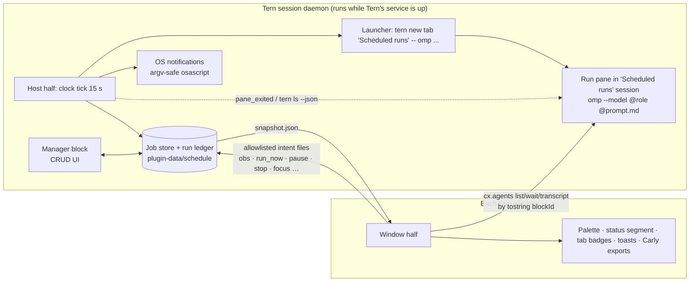

# Architecture decision: Schedule (tern-schedule)

> [!NOTE]
> Historical design notes, written before the build under the working name `schedule`. The shipped plugin is `tern-agent-scheduler` ("Agent Scheduler"); where these notes disagree with the code or the [README](../../README.md), the code and README win. Links to `research/`, `review/` and `engine-src/` point at internal notes that aren't published; the engine now lives in `lib/` and its tests in `test/`.

Status: decided 2026-10-11 from research + two runtime probes on Tern 0.7.2 / omp 18.9.1. Revision 2 applies `decisions.md` (R-ids cited inline) after three reviews.
Evidence keys: `TP` = research/tern-platform.md, `PR1` = research/tern-probe.md, `PR2` = research/tern-probe2.md, `OC` = research/omp-capabilities.md, `LP` = research/local-patterns.md, `PA` = research/prior-art.md, `R<n>` = design/decisions.md.

## Decision

**One Tern plugin, both halves. No omp extension required.**

- **Host half (session daemon) is the brain.** It owns the clock, the job store, the run ledger, the launcher, OS notifications and the manager block. The daemon runs one host VM per plugin, so there is exactly one clock: no multi-window duplicate firing and no leader lease. The manager block and the clock share one Lua VM, so creating and editing jobs never crosses a process boundary.
- **The launcher is the `tern` CLI, called from the host half** (exact argv owned by launch.md §2):
  `tern new tab "Scheduled runs" --json --cwd <cwd> --keep-open -- <abs omp> --model @<role> --approval-mode <mode> --max-time <s> --session-dir <run>/session --append-system-prompt <run>/preamble.md [--config <run>/omp.yml] @<run>/prompt.md "Run the scheduled job described in the attached file."`
  (`tern new session "Scheduled runs" …` when the session does not exist yet). No user text enters argv: Tern joins argv into a `/bin/zsh -l -c` string, so the prompt travels as a per-run snapshot file (R1). The launch returns the daemon block id, never changes the user's shown tab or focus, works with zero windows attached, and the pane is a real omp agent that Tern recognizes in `cx.agents:list()` (PR2 tests 4-5).
- **Window half is the eyes and the chrome.** Palette commands, status-line segment, tab-title badges, toasts, Carly exports, and run-state observation via `cx.agents` addressed by `tostring(blockId)` (the only id form that works, PR2 test 1b).
- **omp is used as-is** through flags: `--model @role`, `--approval-mode`, `--max-time`, `--session-dir`, `--append-system-prompt`, `--config` (a per-run overlay that pins approval of exec-tier tools so a repo's `.omp/config.yml` cannot widen it, R7) (OC §1-2). An optional bundled omp "run reporter" extension (passed per run with `-e <tern.plugin.dir>/omp/reporter.ts`, zero install) is an M3 enhancement for window-independent lifecycle and exact cost; it is not needed for v1.

## Why not the alternatives

| Option | Verdict | Deciding evidence |
|---|---|---|
| Window-half clock with kv leader lease (tern-swarm's pattern) | Rejected | Dies when the last window closes (LP pitfall 4); N windows = N clocks and `tern.kv` has no CAS (TP §2.2, PR1 Q3); window timers run 40-90 s late in the background (LP pitfall 3); and its launcher `cx.agents:start` steals focus and returns an id every other agent call rejects (PR1 headline 2, PR2 test 1). |
| `tern.carly.schedule` as the engine | Rejected as engine; optional bonus | No cron (no day-of-month, ranges, steps); tasks belong to the creating window; ended tasks vanish with no history; the check runs once at schedule time (dry run side effects); must be created from a callback (PR2 test 6, TP §2.8). |
| External launchd/cron calling `tern new` | Rejected for v1 | Needs a running daemon anyway (`tern new` targets the daemon), lives outside Tern's UI, and requires writing into `~/Library/LaunchAgents`. Kept as an opt-in "start Tern's daemon at login" helper idea (open question). |
| omp-only extension with timers | Rejected | Extension timers die with the omp session; no clock when no omp is running (OC §7-8). |
| `cx.layout:new_tab(launch, {focus=false})` from the window | Fallback only | No focus steal, but the returned window id is unusable for `wait/transcript/stop` and it needs a window (PR2 test 3). |

## Responsibilities

| Concern | Host half | Window half |
|---|---|---|
| Clock, due computation, missed/overlap/catch-up policy | ✔ (single writer) | — |
| Job + run storage (`tern.plugin.data`) | ✔ writes | reads `snapshot.json`; writes intent files only |
| Launching runs | ✔ `tern.process.run` with absolute `tern` path (host PATH is `/usr/bin:/bin:/usr/sbin:/sbin`, PR1 Q1) | — |
| Liveness of run panes | ✔ host event `pane_exited`; `tern ls --json` per tick while runs are in flight; a pane counts as the run only if its command still contains the run-id path (R12, R14) | — |
| Agent state (working / idle / waiting_input), last message, transcript | — | ✔ `cx.agents:list()` joined via `cx.session:resolve(tostring(block))`; `wait`/`transcript` by `tostring(block)` → reported back as intents |
| Stop a run | `tern close <block>` (works without a window) → `cancelled/user_stop` | M2: Interrupt (keep pane) via `cx.agents:interrupt(tostring(block))` |
| Bring a run to front ("Open run") | `tern focus <block>` (works, PR2 test 1c); closed pane → new tab running `omp --session-dir <run>/session --resume <session>` | — |
| Manager CRUD UI (the only place jobs and settings are created or changed) | ✔ host block | palette commands open it via `cx:new_block` with draft args (M1 gate) |
| OS notifications | ✔ argv-passing `osascript`, deduped by the single writer (R8) | — |
| Status segment, toasts, (M2) tab badges, (M3) Carly exports | — | ✔ |

Host→window: `snapshot.json` (published by the host after every state change) plus the host-written kv key `hot` (rev, counters, heartbeat); windows never write kv (R11). Window→host: one JSON file per message under `<data>/intents/`, named `<t_ms>-<win8>-<seq>.json`, drained by the host tick in name order (tern-swarm pattern, LP pattern 9). **Only allowlisted, non-escalating kinds are accepted** (`obs`, `run_now`, `pause`, `resume`, `pause_all`, `resume_all`, `stop_run`, `focus_run`, `open_run`, `roles_request`, `ack_failed`); there are no create, update, delete or settings intents, because any process running as the user, including a scheduled agent, can write that folder (R10, RF S1). Windows send raw agent samples plus a 30 s heartbeat; the host owns debouncing and every state transition (R9). The host stays the only writer of jobs and runs.

## Availability contract (what users are told)

User-facing copy (R20): "Jobs run while Tern's session service is running. It keeps running after you close windows as long as a terminal or run is still open. Nothing runs while your Mac is asleep, or after a restart until you open Tern."

- Jobs fire while Tern's session daemon is running; windows may all be closed (PR2 test 5, isolated daemon). Whether the production SMAppService daemon behaves the same with zero windows is a gating M1 check (launch.md V-items).
- The daemon starts with Tern.app and exits when no window is attached and no program is live (PR2 test 5). Kept-open run panes and the user's normal shells keep it alive. After a reboot nothing fires until Tern is opened (TP §2.1 survival matrix). A Setup "Keep-alive" row reads `tern ls --json` and warns when nothing would keep it alive.
- A sleeping Mac fires nothing. On the next tick the engine applies the job's catch-up policy (one run for the most recent missed slot within the catch-up window, default 3 h; older slots recorded as missed) (PA §5.3, R19).
- Without a window, agent state is invisible: a run that stops for approval waits until a window opens or its time limit hits. Host-visible failures (launch failure, early exit, timeout, blocked) still notify (R8).
- `tern` CLI commands act on "one window's sessions… else the first window", and plugins cannot read `TERN_WINDOW_KEY` (PR2 test 7). Whether sessions are daemon-wide or per window with two windows open is a gating M1 check; if per window, runs land in the first window (R21).
- Plugin reload drops VMs and timers but not panes; the host reconciles in-flight runs from the ledger + `tern ls --json` on load (PR1 headline 9). A daemon restart can restore a pane as a plain login shell, which is why liveness checks the run-id path in the pane's command (R12).

## Platform issues to report to Stencil (found by the probes)

1. Window pane ids returned by `cx.agents:start`, `cx.layout:new_tab` and `cx.agents:list()` are rejected by `cx.agents:wait/transcript/stop`, `cx.session:pane/resolve` and `cx.layout:park/close/focus` (`pane runs no agent` / `agent not found` / `unknown block`). Only the daemon block id as a string works (PR2 test 1b).
2. `cx.agents:start` has no `focus` option and always focuses the new tab; `cx.layout:focus(prev)` does not restore it (PR2 test 1).
3. `cx.layout:park` fails for every id form tried (PR2 test 1c).
4. `tern rename <block>` renames the tab, not the block; there is no CLI or API to title a block (PR2 test 4).

The design avoids all four, so none block v1. If Stencil fixes 1-2, a window-side launcher becomes viable for remote hosts (out of scope for v1).

## Milestones (R23)

**M1 gate (spike first, before any other UI work):** a palette command opens the host manager block via `cx:new_block` with draft args; multi-line text editing in a host block (tern-swarm `textfield`); a `prefs` node inside a host block. Fallback if multi-line editing misses its time box: a one-line prompt field + `ctrl+o` opening `prompts/<id>.md` in Tern's doc editor. The other gating checks (argv quoting, `@file` auto-submit, `--keep-open`, overlay precedence, two-window session scope, real-daemon lifetime) are ordered in launch.md's verification checklist.

1. **M1 Minimum lovable loop** (create → it fires → I see it ran / needs me / failed → I open the result): engine (cron/schedule/policy with tests, store, ledger, host clock, preflight, overlap skip, cap, catch-up, pause-all, auto-pause); launcher with placements *Scheduled runs session* (default) and *Background tab in the current session* plus a *Bring to front* switch; minimal window observer (needs you / finished / failed / last message); status segment; toasts; host OS notifications; Open run; run history with reasons; finished-pane cap of 5; manager list + detail + 9-row form; Run now, Pause/Resume, Delete with undo, Duplicate, Pause all; palette Open manager, New job, Run a job now, Go to run that needs me; Setup check; empty state with examples; first-run "Run now and watch".
2. **M2 Depth**: split and picture-in-picture placements (after their checks pass), tab badges, Interrupt (keep pane), Recent runs and Pause/Stop pickers, per-job notify / after-run / overlap options, Quick add, filter, quiet success, fuller settings sheet.
3. **M3 Reach**: Carly exports (create as draft only), git worktree isolation, bundled omp run-reporter extension, "Allowed commands" overlay (if not pulled into M1 by open question 1), export/backup.
